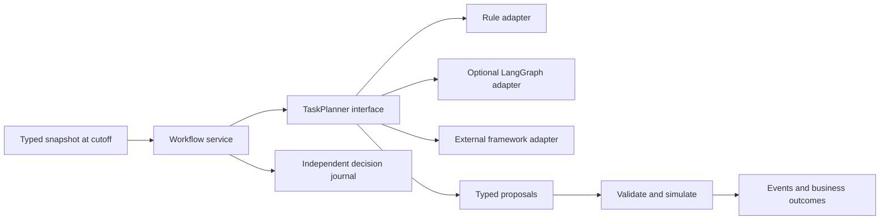

# Architecture

How the WORKCAST simulation platform is built. For file and API shapes see `contracts.md`; for the pages see
`ui.md`; for the instances and their results see `validation.md`.

## 1. One platform, many instances

The platform is the product; an instance is one company turned into a simulated world. The platform never contains
instance logic. An instance is a folder under `instances/<id>/` holding its data, ontology bindings, seat policies,
calibration, scenarios, evaluation protocol and report builder. The four world types in use are:

- **workforce** (`orgsim/worlds/workforce.py`): a population of employees, each a digital twin with a fixed trait
  layer and weekly latent states (job satisfaction, work-life balance, commute burden, attachment), reacting to a
  policy over time. Used by `trip` and `ctrip`; `fedwork` uses cohort counts and competing separation hazards.
- **process** (`orgsim/worlds/process.py`): work items flowing through activities performed by role pools under
  capacity and process constraints, with a payment-run calendar and same-person continuity. Used by `bpi19`.
- **market** (`orgsim/worlds/market.py`): companies whose AI workloads run on models at published list prices. Each
  company has a token volume, a growth path and a persistence class (one-off job, recurring, steady product); each
  use-case segment holds workload agents that choose among the models listed that week, and a buyer seat judges each
  newly listed model. Calibrated at every cutoff from backtests that end before it, with the specification chosen per
  persistence class; the central path (every shock at its median) is the point prediction and the runs give the ranges.
  Used by `openrouter`.
- **adoption** (`orgsim/worlds/adoption.py`): populations of agents in groups (sectors, roles, a whole site) taking up
  a technology. Each period non-users may start and users may stop, with hazards that move each group's expected share
  along a diffusion path (logistic imitation or a constant external hazard; growth shared across groups, damped). The
  outcome is the share itself or a volume the adoption displaces (baseline trend and seasonality fitted before the change,
  times the share not yet switched). Calibrated at each cutoff from backtests that end before it; comparators include
  carry-forward, recent average, linear trend, damped-trend smoothing and a Bass diffusion fit. Used by `btos_ai`, `aei_tasks` and
  `so_chatgpt`.

A world type exposes three functions: `World` (the simulation), `evaluate(ctx, scenario_ids)` (scores the
baseline against ground truth and writes `runs/<id>/evaluation.json`) and `results_view(ctx)` (the document the
Results tab renders, including the hero block).

## 2. Kernel and policies

The kernel owns time, capacity and state: an hourly clock, a scheduler, capacity pools per role, and the latent-state
dynamics declared per instance. Policies only choose. Every decision point offers the seat an `Observation` with
options and prior-driven weights (work from home or office on an eligible day; stay or quit this week; the next step
for a purchase-order item), and the seat's adapter returns one option:

- `rule`: draws from the offered weights (transparent, deterministic given the seed);
- `llm`: a hosted Anthropic model reads the same observation, including the twin's profile and states, and chooses;
- `local`: an OpenAI-compatible local server;
- `openai`: an OpenAI model through Chat Completions, with a response cache (reruns repeat decisions without calls) and a
  spending cap. Besides choosing one option it can give a number per option (`estimate`), as the market buyer seat does.

Failures fall back to the rule policy and the fallback is recorded in the trace. `policies/seats.yaml` maps seats
(role ids) to adapters, so swapping a model is configuration.

## 3. Digital twins (workforce worlds)

Each employee carries the real covariate vector of one experiment participant. Once per run a trait layer is computed from
those covariates and the sampled priors: baseline satisfaction, baseline quit hazard, a work-from-home preference
trait that drives both take-up and the value of each home day, commute. A text profile is rendered from the traits
and offered to every seat. Weekly, the kernel updates the latent states with inertia, team comparison (employees not
offered the policy while teammates are), and an amenity channel; the quit hazard combines satisfaction, commute,
the direct value of the arrangement and attachment. Every run writes `twins.json` with traits, final states and
outcomes per twin; the Runs page shows the twin card and Insights interviews them.

The design follows the finding (see `literature/foundations.md`) that employee states are trait-like: fidelity comes
from the fixed trait layer and kernel-owned dynamics, not from per-decision language-model reasoning.

## 4. Ontology

`orgsim/ontology/schema.py` defines the concepts (Organization, OrgUnit, Person, Role, Occupation, GWA, IWA, DWA,
Task, Activity, WorkItem, Artifact, System, Capability, Location, ExternalActor, Message, Policy, Event, LatentState)
and the relations they may have (has, member_of, part_of, has_role, bound_to, performs, maps_to, located_at,
same_manager, hands_off_to, affects, has_state, ...), each with a one-line definition. Roles are bound to O*NET-SOC
occupations and activities to O*NET detailed work activities, so roles in different companies share a vocabulary.
`bindings.py` turns an instance's `ontology/bindings.yaml` into a typed graph; `system.py` reports which concepts
and relations an instance uses and how many; `people.py` builds the data graph (who the people are and who each is
connected to: teammates in workforce worlds, hand-off partners in process worlds).

## 5. Evaluation and results

Each instance has `evaluation/protocol.yaml` (what is scored, against what, with which baselines). `evaluate()`
runs only the after-change predictions, compares to reference outcomes and non-simulation predictors, and writes metrics, intervals, charts
and matching-cutoff/seed scenario comparisons. Before periods are observed data only. Run IDs pin the display cohort; per-window business errors prevent cancellation across cutoffs. `results_view()` assembles the Results document: actual outcomes, non-simulation comparison methods,
simulation predictions, and alternative simulation predictions, key metrics with ranges, treatment effects (workforce), trajectories, the report
narrative, and the hero block. Reports (`reports/report.json`) are generated by each instance's `build_report.py`
from the evaluation and run outputs; the narrative appears under Results.

### AI assistance as an exploratory intervention

The `ai_assist` intervention reduces or increases expected human effort for named
tasks. Coverage mixes assisted and unassisted work. The effort factor is
`1 − coverage × (time_saved − review_overhead − rework_rate × rework_effort)`.
Review and correction are included; overhead can outweigh time savings. All five
inputs are scenario assumptions, not coefficients fitted to historical outcomes.

In procurement, tasks consume ordinary-action equivalents from the same hourly
role pools. Invoice clerks still perform the reviewed task; matching constraints,
vendor timing, staffing, and payment calendars remain in force. Lower effort can
change queues and subsequent process events. Human hours are inferred from modeled
throughput; they are not observed touch-time measurements.

In Trip.com, expected task shares from role definitions are applied to every active
employee's scheduled work hours, independently of sampled trace rows. The result
is effort released for other work. No unsupported link to attrition, satisfaction,
performance grades, additional output, or monetary savings is introduced.

The AI comparison assumes corrections happen before completion. It does not predict
residual AI errors or estimate implementation, training, or model-service costs.
The cited writing and customer-support studies motivate exploration; they do not
validate the assumed effects at these companies.

`orgsim/evaluation/exploration.py` runs and stores matched alternative comparisons
separately from historical accuracy evaluation. Results use only the saved pairs;
fingerprints hide stale outcomes after settings or model inputs change.

## 6. Insights

`orgsim/insights/interview.py` interviews a stratified sample of agents from the latest baseline and alternative
runs about the key metrics. Facts come from the agent's simulated record (twin traits, states, decisions; or a role
pool's utilization, waits and exceptions). Answers are rendered by a deterministic template voice, or by a hosted
model over the same facts when an API key is set. Topics and sentiment are derived from the facts, not from the
voice, so the extraction is stable. Aggregates per scenario and a baseline-versus-alternative comparison are
written to `runs/<id>/insights.json`.

## 7. Server and UI

`orgsim/server/app.py` is a FastAPI app serving the JSON API (every endpoint is listed in its docstring) and the
build-free UI under `ui/` (static HTML, CSS and ES modules; Chart.js, Cytoscape and marked from cdnjs). UI files are
served with no-cache headers and a version stamp so edits show on reload. Instances may add detailed views under
`instances/<id>/ui/`, embedded in Results.

## 8. Stack

Python 3.12 (`.venv` via uv), pandas, pyarrow, numpy, scipy, pydantic, FastAPI and uvicorn, httpx. Parquet for
traces, JSON for run summaries and documents, YAML for everything a person edits. No node toolchain.

## 9. Extension design: ports and adapters

The application boundary is implemented in `orgsim/application/`. CLI runs,
CLI evaluation, HTTP Results and alternative-action execution use
`SimulationService`; `orgsim/composition.py` binds it to existing world adapters.
The four scientific models retain their equations and data formats. Their internal
batch evaluators still read instance files and create runs: these compatibility
adapters are an incremental extraction, not complete isolation of every legacy IO
operation. They do not resolve the instance data/claim questions tracked in issues
[#4–#9](https://github.com/yikun-chi/workcast_demo/issues?q=is%3Aissue+assignee%3Asumervaid).

| Port | Responsibility | Implemented adapter |
|---|---|---|
| `DataSnapshot[T]` | Return a typed observation at a cutoff | `RecordSnapshot`: effective and availability timestamps, latest available task vintage |
| `SimulationModel` | Run a configured model, emitting events and outcomes | `InstanceModel`: workforce, process, market and adoption |
| `TaskPlanner[Observation, Plan]` | Propose assignments from an allowed observation | Deterministic rule, optional LangGraph, external `module:factory` |
| `RunRepository` / `RunSink` | Begin, write, complete or abort a model run | Local Parquet/JSON with existing artifact shapes |
| `OutcomeScorer` | Coordinate the existing instance evaluation | `InstanceScorer`: same scoring and matched alternatives |
| `ResultsPresenter` | Supply before/change/comparison/alternatives | `InstancePresenter`: existing Results documents |
| `DecisionRepository` | Durably store accepted decisions and completed workflow checkpoints | SQLite write-once journal, independently of framework checkpoints |

The core ports import no agent SDK, web framework, world implementation or storage
client. `tests/test_architecture.py` checks the dependency direction, all eight
instance bindings, failure cleanup and numerical parity on real workforce twins.
This follows [ports-and-adapters architecture](https://alistair.cockburn.us/hexagonal-architecture).

### Framework-independent task workflow

`orgsim workflow` is a runnable, authored process exploration with a fixed task DAG,
worker skills, human and AI capacity, review and correction. It is separate from the
eight real-data instances and makes no observed-accuracy or AI-benefit claim. See
[the example and runnable commands](../examples/README.md).

The planner selects a skilled assignee, human reviewer and human correction worker
for each visible task. The kernel decomposes these into work, review and, when the
seeded quality draw requires it, correction. It validates the entire batch, enforces
task dependencies and resource slots, and computes operating time and effort. The
fixed DAG and effort/quality assumptions are scenario inputs; a planner cannot
invent tasks, capacity, effort savings or actual outcomes. Dynamic task generation
would need an explicit domain contract and kernel validation before being allowed.

The rule and LangGraph adapters use the same deterministic assignment policy by
default. Their matched outputs therefore test interchangeability, not an advantage
of either framework. The optional LangGraph adapter uses `Send` fan-out and a local
SQLite checkpointer; the application sees only portable `Observation` and `Plan`
objects. See the official [worker pattern](https://docs.langchain.com/oss/python/langgraph/workflows-agents)
and [checkpoint documentation](https://docs.langchain.com/oss/python/langgraph/persistence).
No LLM service or key is needed for this example.

### Switching frameworks

LangGraph is one adapter, not the platform's task-planning foundation. A separately
installed package can provide `create(*, checkpoint_dir, **options)` returning the
`TaskPlanner` contract, selected with `--planner package.module:create`. It can use
Microsoft Agent Framework, another SDK or ordinary Python internally. Microsoft
provides its own [workflow/executor model](https://learn.microsoft.com/en-us/agent-framework/workflows/workflows);
that state and its async execution belong inside the adapter. A Microsoft SDK
adapter is not bundled or claimed to have been tested here. The external-factory
contract is tested with a substitute package, independently of LangGraph.

An adapter returns stable command IDs, typed assignments, model/prompt identity,
usage/cost metadata and any fallback. It must change its identity when its policy,
prompt, model settings or behavior changes. Unknown usage is `null`, never an
assumed free call. SDK messages, graph nodes, thread IDs and checkpoints are not
business-domain types. The builtin LangGraph custom-worker hook records its supplied
worker identity; unknown usage stays null. A production model adapter should gather
provider usage and populate the complete `Plan` metadata.

### Time, evidence and recovery

The snapshot rejects missing availability timestamps and filters both effective and
available dates. An announced future arrival is a scenario input, not later observed
work. Resource efficiencies and quality rates are authored assumptions. Actual
outcomes are absent from the planner contract. This boundary applies to the new
workflow, not retroactively to the legacy market or federal datasets.

Decisions are committed before kernel execution. A restart reuses that decision;
repeated command IDs with identical payloads apply once, and conflicts fail. Each
completed run stores its seed, kernel identity, events and outcomes. `--replay`
recomputes and verifies it without any planner or credentials. SQLite also protects
against conflicting concurrent journal writes; this local demo is not a distributed
exactly-once provider-call system. A worker interrupted before its checkpoint may
be invoked again and must keep external side effects idempotent.

LangGraph resumes unfinished workers from its own durable checkpoint. Its execution
state is separate from the simulation checkpoint. Tests cover interrupted workers,
restart after decision commit, persistence across processes, reversed proposals and
parallel versus serial workers. Framework concurrency never creates staff capacity;
network latency never becomes business duration. The computed workflow outcomes
are completed work, throughput, mean elapsed time, staff effort, correction rate
and assumed AI service cost. Model planning cost is recorded separately.
