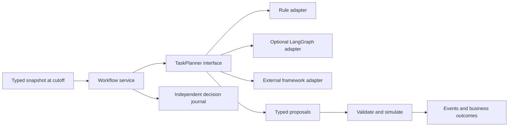

# Task-planner architecture

For application-wide boundaries, see [architecture](architecture.md#9-extension-design-ports-and-adapters).
For canonical data shapes, see [contracts](contracts.md#10-application-ports-and-task-planner-extensions).

## Planning and simulation

`orgsim workflow` is a runnable, authored process exploration with a fixed task DAG,
worker skills, human and AI capacity, review and correction. It is separate from the
eight real-data instances and makes no observed-accuracy or AI-benefit claim. See
[the runnable commands below](#run-the-example).



The planner selects a skilled assignee, human reviewer and human correction worker
for each visible task. The kernel decomposes these into work, review and, when the
seeded quality draw requires it, correction. It validates the entire batch, enforces
task dependencies and resource slots, and computes operating time and effort. The
fixed DAG and effort/quality assumptions are scenario inputs; a planner cannot
invent tasks, capacity, effort savings or actual outcomes. Dynamic task generation
would need an explicit domain contract and kernel validation before being allowed.

The rule and LangGraph adapters use the same deterministic assignment policy by
default. Their matched outputs therefore test interchangeability, not an advantage
of either framework. The optional LangGraph adapter uses `Send` fan-out and a local
SQLite checkpointer; the application sees only portable `Observation` and `Plan`
objects. See the official [worker pattern](https://docs.langchain.com/oss/python/langgraph/workflows-agents)
and [checkpoint documentation](https://docs.langchain.com/oss/python/langgraph/persistence).
No LLM service or key is needed for this example.

## Switching frameworks

LangGraph is one adapter, not the platform's task-planning foundation. A separately
installed package can provide `create(*, checkpoint_dir, **options)` returning the
`TaskPlanner` contract, selected with `--planner package.module:create`. It can use
Microsoft Agent Framework, another SDK or ordinary Python internally. Microsoft
provides its own [workflow/executor model](https://learn.microsoft.com/en-us/agent-framework/workflows/workflows);
that state and its async execution belong inside the adapter. A Microsoft SDK
adapter is not bundled or claimed to have been tested here. The external-factory
contract is tested with a substitute package, independently of LangGraph.

An adapter returns stable command IDs, typed assignments, model/prompt identity,
usage/cost metadata and any fallback. It must change its identity when its policy,
prompt, model settings or behavior changes. Unknown usage is `null`, never an
assumed free call. SDK messages, graph nodes, thread IDs and checkpoints are not
business-domain types. The builtin LangGraph custom-worker hook records its supplied
worker identity; unknown usage stays null. A production model adapter should gather
provider usage and populate the complete `Plan` metadata.

## Time, evidence and recovery

The snapshot rejects missing availability timestamps and filters both effective and
available dates. An announced future arrival is a scenario input, not later observed
work. Resource efficiencies and quality rates are authored assumptions. Actual
outcomes are absent from the planner contract. This boundary applies to the new
workflow, not retroactively to the legacy market or federal datasets.

Decisions are committed before kernel execution. A restart reuses that decision;
repeated command IDs with identical payloads apply once, and conflicts fail. Each
completed run stores its seed, kernel identity, events and outcomes. `--replay`
recomputes and verifies it without any planner or credentials. SQLite also protects
against conflicting concurrent journal writes; this local demo is not a distributed
exactly-once provider-call system. A worker interrupted before its checkpoint may
be invoked again and must keep external side effects idempotent.

LangGraph resumes unfinished workers from its own durable checkpoint. Its execution
state is separate from the simulation checkpoint. Tests cover interrupted workers,
restart after decision commit, persistence across processes, reversed proposals and
parallel versus serial workers. Framework concurrency never creates staff capacity;
network latency never becomes business duration. The computed workflow outcomes
are completed work, throughput, mean elapsed time, staff effort, correction rate
and assumed AI service cost. Model planning cost is recorded separately.

## Run the example

Run these commands from the repository root after [installation](setup.md#installation).
The workload is [examples/task_workflow.json](../examples/task_workflow.json).

Run the deterministic planner with the base installation:

```bash
uv run orgsim workflow --planner rule
```

Run the same policy through the optional LangGraph adapter:

```bash
uv sync --locked --extra dev --extra langgraph
uv run --extra langgraph orgsim workflow --planner langgraph
```

Both commands hold tasks, resources and seed fixed. Their business outcomes should
match: this checks framework interchangeability, not an AI productivity improvement.
Changing the planner's software concurrency does not change business capacity:

```bash
uv run --extra langgraph orgsim workflow --planner langgraph --planner-options '{"max_concurrency": 1}'
```

The command prints a run key, artifact path, trace and computed outcomes. Outputs
stay in ignored `runs/workflow/`. `decisions.sqlite` stores the portable input,
planner identity, accepted plan and completed simulation; `langgraph.sqlite` is
framework execution state. Replay a printed run key without either the planner or
its SDK:

```bash
uv run orgsim workflow --replay <run-key>
```

Use `--spec path/to/scenario.json` for another authored workload. Unknown fields and
missing availability timestamps are rejected. Task versions after the cutoff do
not enter observations. Every task needs a skilled worker and a skilled human for
review/correction. Capacity is simultaneous work slots; time is continuous operating
hours with no inferred working-day calendar. Error rates, speeds and costs are
assumptions supplied in the file. Corrections consume human effort and are assumed
to resolve the error. There is no residual-quality or adoption model here.

The planner chooses assignments for a fixed task DAG. The kernel creates work,
review and conditional correction operations, enforces capacity and dependencies,
then computes:

- Completed tasks and throughput within the supplied horizon.
- Mean arrival-to-completion hours among completed tasks (null if none).
- Human hours actually worked within the horizon, including review and correction.
- Fraction of reviewed tasks requiring correction (null if none reviewed).
- AI service cost for work performed, using the supplied hourly rate.

Planning API costs are separate metadata, never added to simulated effort. The
builtin planners call no paid model; their planning usage/cost is zero. Custom
worker usage is unknown unless supplied through a full adapter.

## Implement an adapter

An installed module exports a factory taking `checkpoint_dir` and its options. Its
returned object needs only:

```python
from orgsim.workflow.contracts import Observation, Plan

class MyPlanner:
    @property
    def identity(self) -> dict[str, str]:
        return {"adapter": "my-framework", "policy": "my-policy", "model": "my-model", "prompt": "my-prompt"}

    def plan(self, observation: Observation) -> Plan:
        # Run your framework internally; translate its output into a validated
        # Plan, with command_id(observation, task.id) for each task.
        # Include actual provider usage/cost, or null when unknown.
        ...

def create(*, checkpoint_dir, **options):
    return MyPlanner()
```

The skeleton is an interface illustration; supply the implementation in your own
package. Then select it without modifying the kernel or application:

```bash
uv run orgsim workflow --planner my_package.planner:create --planner-options '{}'
```

This route supports an adapter implemented with Microsoft Agent Framework or any
other planner. No Microsoft SDK integration is bundled. SDK execution, credentials,
model calls and checkpoints stay inside that package; the simulation receives only
portable proposals. Change the planner identity whenever its behavior changes to
avoid reusing a decision for a different policy. Keep external calls idempotent for
retries; the demo journal does not guarantee exactly-once calls to external APIs.
